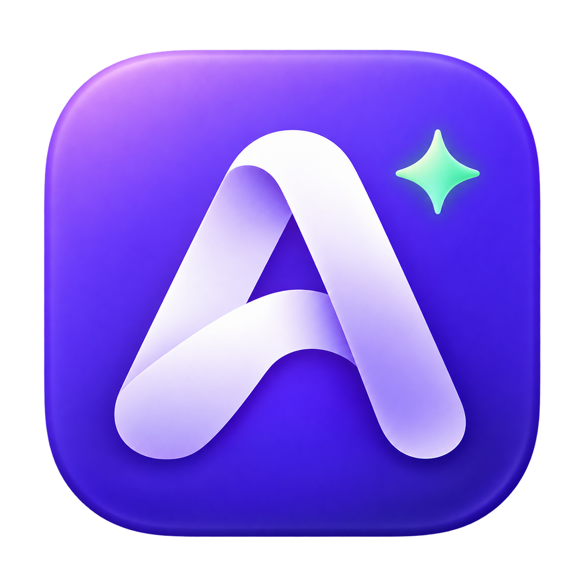
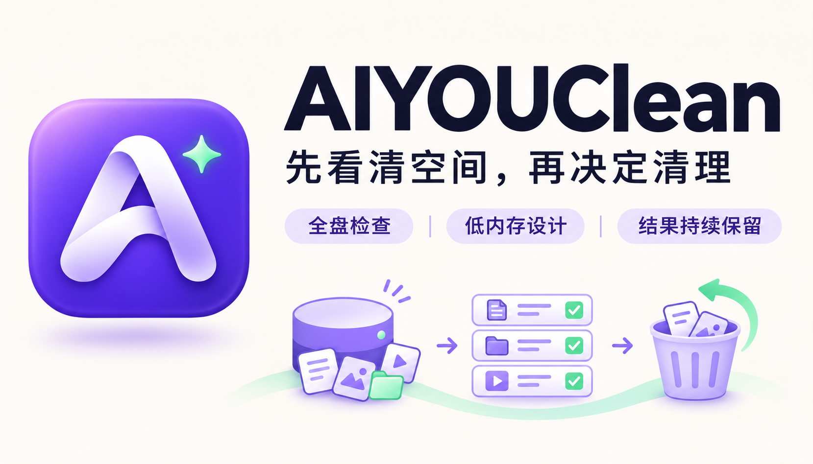
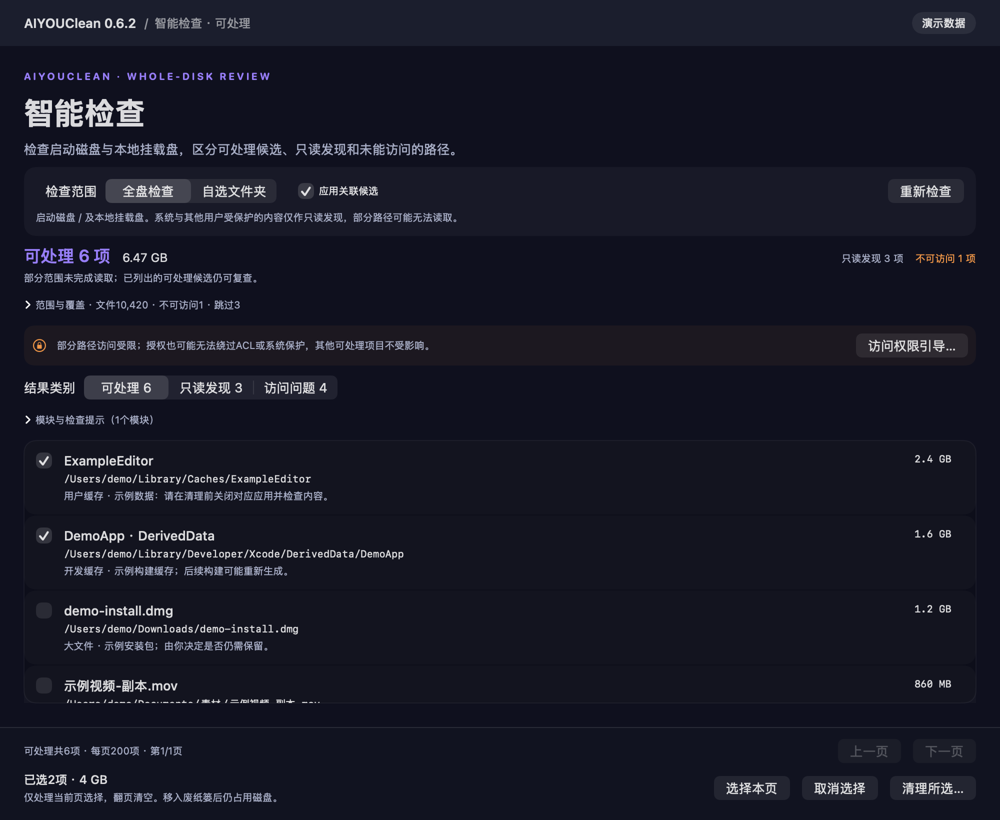
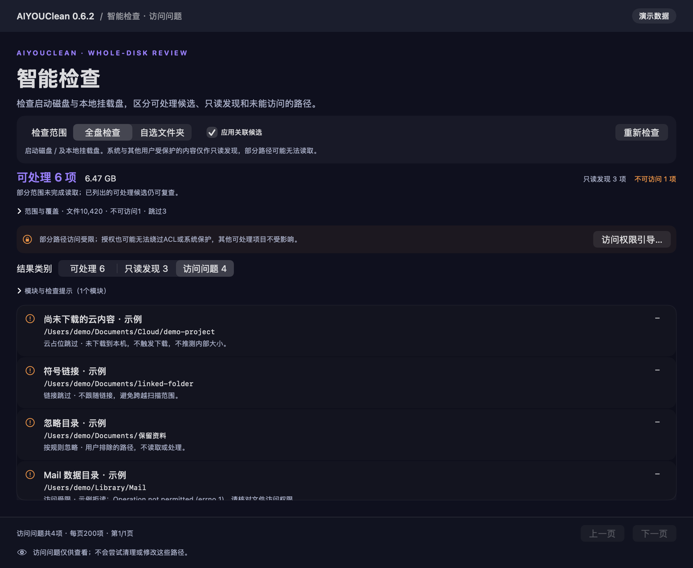
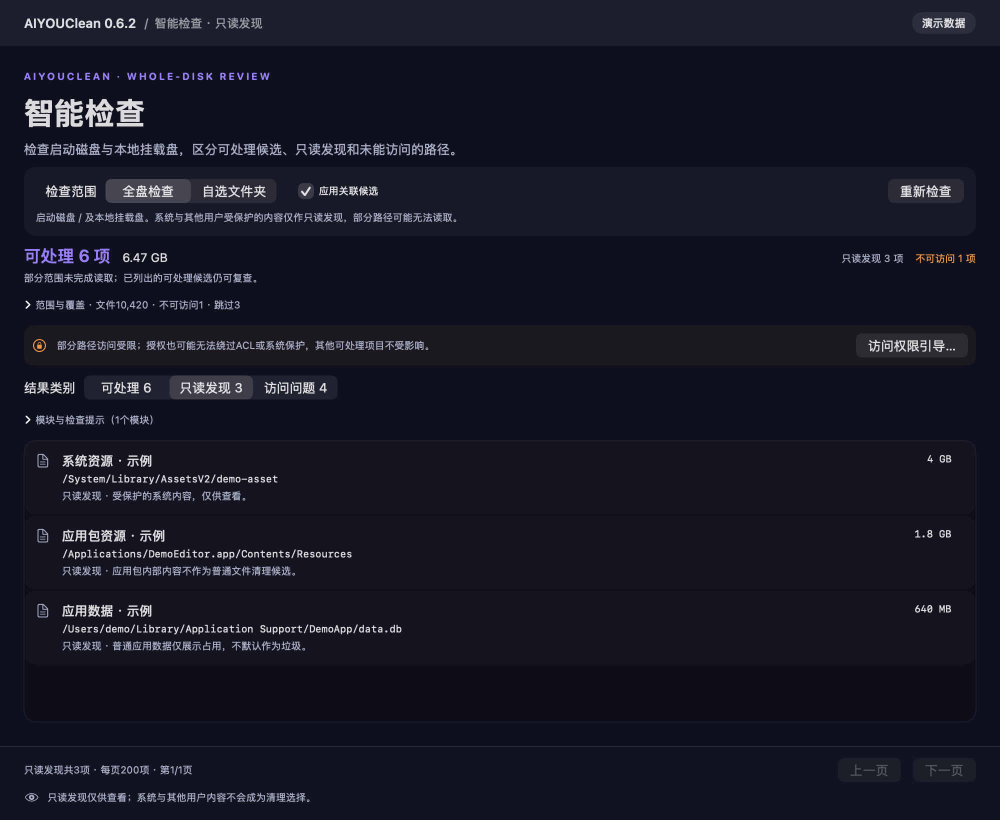
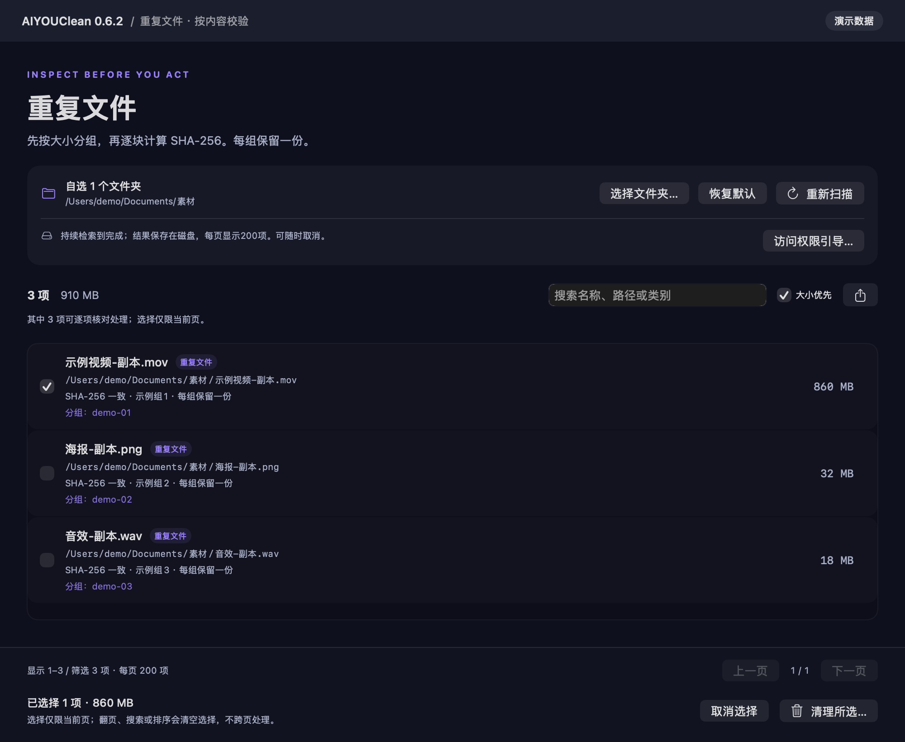
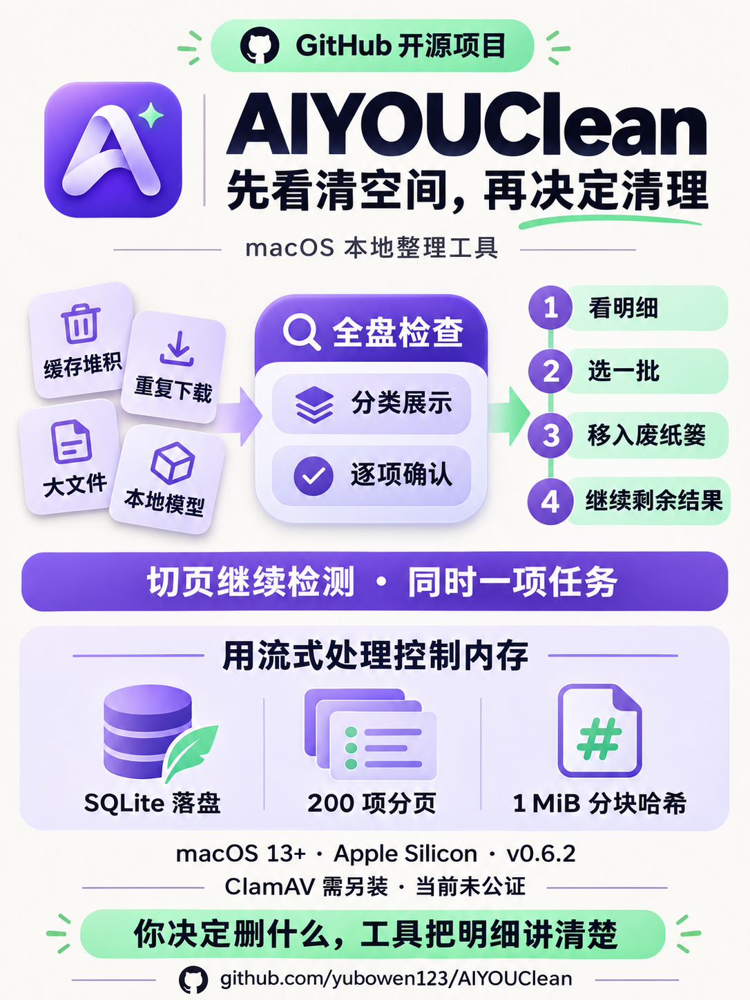

<div align="center">
  
  <h1>AIYOUClean</h1>
  <p><strong>先看清空间，再决定清理。</strong></p>
  <p>给 Mac 做一次看得懂、选得明白、能分批处理的空间检查。</p>
  <p>
    <a href="https://github.com/yubowen123/AIYOUClean/releases/latest">下载 macOS 版</a> ·
    <a href="docs/INSTALL.md">安装指南</a> ·
    <a href="docs/FEATURES.md">功能与边界</a> ·
    <a href="docs/ARCHITECTURE.md">实现原理</a> ·
    <a href="docs/images/knowledge-card.png">一图看懂</a>
  </p>
  <p>macOS 13+ · Apple Silicon · SwiftUI · MIT · v0.6.2</p>
</div>



## 磁盘满了，先别急着点清理

缓存、重复下载、大文件、本地模型……空间一点点被吃掉，最麻烦的是搞不清哪些能动、动完之后还能不能接着处理。

AIYOUClean 把这条链路做直：**检查 → 看明细 → 选一批 → 确认处理 → 继续看剩余结果。** 默认只检查，普通清理移入系统废纸篓。你决定删什么，工具负责把路径、大小、保留项和处理结果讲清楚。

这是一个持续迭代的 macOS 原生开源工具。名称中的 AIYOU 是项目品牌；当前文件分析使用本地规则、SHA-256 和图片差异哈希，不调用大模型。

## 三件事，先做好

| 你关心的事 | 当前怎么做 |
| --- | --- |
| 检查范围要够大 | 智能检查覆盖启动磁盘与已挂载本地数据盘；也能自选文件夹。可处理、只读发现、访问问题分开展示。 |
| 扫描别把内存吃满 | 结果和查重索引写入 SQLite，每页只读 200 项；SHA-256 以 1 MiB 块读取。正常扫描持续到完成或主动取消。 |
| 清一部分后别让我重来 | 只移除成功处理的条目，剩余和失败项继续显示；保留筛选、排序和页码，可继续下一批。 |

检测期间可以切换页面。顶部任务栏负责进度、返回和取消；同一应用实例同时只运行一项检测或处理，汇总阶段也占用这一名额。

## 看看实际界面

以下为 **0.6.2 当前 SwiftUI 页面渲染，使用生成的演示数据**。数值仅帮助理解操作，不是性能成绩或真实用户扫描结果。[截图来源与复现](docs/screenshots.md)

### ① 先检查，再逐项选择



### ② 访问受限的内容，单独讲清楚



<details>
<summary>继续看只读发现和重复文件</summary>





</details>

## 现在能做什么

- **整理空间**：用户缓存、日志、Xcode DerivedData、大文件与旧文件、下载文件、本地 AI 模型和 Mail 下载附件。
- **减少重复**：按大小分组后计算完整 SHA-256，重复组保留一份；图片差异哈希给出视觉近似候选，需人工核对。
- **看清占用**：空间导航可下钻，区分逻辑量与分配量；应用卸载按精确 bundle ID 关联支持文件，残留只作为待核对候选。
- **补齐日常维护**：高级清理、受控废纸篓清点、文稿版本归档恢复、Chrome / Firefox 本地隐私、系统监控与只读安全状态。
- **可选查杀**：接入外部 ClamAV，需要自行安装引擎和病毒库；本次发布未做真实病毒检出验收。

完整范围、默认目录与当前隐藏入口见 [功能说明](docs/FEATURES.md)。云盘/邮箱连接、全量应用更新、登录与后台管理等未闭环能力不开放产品入口。

## 开始使用

### 下载安装

1. 从 [Releases](https://github.com/yubowen123/AIYOUClean/releases/latest) 下载 `AIYOUClean-0.6.2-macOS-arm64.zip`。
2. 解压，将 `.app` 拖进“应用程序”或 `~/Applications`，打开应用。
3. 第一次先选熟悉的文件夹检查，再按需要使用全盘检查。

当前安装包仅 Apple Silicon，目标 macOS 13+，本机 arm64 验证；尚无 Intel 包或 Apple 公证。首次打开若被系统拦截，按 [安装指南](docs/INSTALL.md) 查看原因和系统允许入口。

也可以下载并查看安装脚本后执行；脚本校验 Release 文件的 SHA-256，默认安装到 `~/Applications`，不自动启动检测或修改系统安全设置：

```bash
curl -fL https://raw.githubusercontent.com/yubowen123/AIYOUClean/main/scripts/install.sh -o /tmp/aiyouclean-install.sh
bash /tmp/aiyouclean-install.sh
```

### 从源码构建

需要 macOS 和 Xcode Command Line Tools 的 Swift 工具链，无必需第三方 Swift 包。

```bash
git clone https://github.com/yubowen123/AIYOUClean.git
cd AIYOUClean
bash scripts/build.sh
open dist/AIYOUClean-0.6.2.app
```

只读 CLI 示例：

```bash
./dist/aiyouclean-cli-0.6.2 scan duplicates --full \
  --root "$HOME/Downloads" --output "$HOME/Desktop/aiyouclean-report.json"
```

`--output` 需要一个尚不存在的目标文件。CLI 不提供删除命令；报告可能包含个人路径，分享前请自行核对。[更多开发与验证说明](docs/DEVELOPMENT.md)

## 使用前，知道这几个边界

- **全盘检查有权限边界。** 完整磁盘访问需在系统设置手动授权当前应用；部分系统保护、ACL 和其他用户内容仍可能不可读。不会自动提权，不下载云占位文件，不跟随符号链接，默认不扫描网络卷。
- **移入废纸篓后仍占空间。** 普通清理有历史回执，可尝试恢复；高级永久删除有独立确认，无法按普通废纸篓方式恢复。逻辑量也不等于 APFS 实际可释放空间。
- **结果保留在本次应用会话。** 切页和分批清理不重置结果；重扫、改变范围或忽略规则会使相应旧报告失效。退出应用后不能续扫，需要保留时导出 JSON。
- **内存设计有界，不承诺固定峰值。** 200 项是页大小，512 MiB 是采样参考预算；它们都不代表扫描数量上限，也不是操作系统内存配额。

## 开源，也把验证讲明白

0.6.2 已有 **44 组 Core 检查**，部分清理保留结果 **10 个隔离场景 / 70 条断言**，以及跨页任务和清理底栏回归。开发中的文件移动、恢复和永久删除验证只使用生成夹具。

这些结果说明指定场景通过，不代替所有用户磁盘、所有 macOS 版本或真实 ClamAV 查杀验收。[验证范围](docs/VALIDATION.md)

欢迎提交能复现的问题：应用版本、macOS 与芯片、操作步骤、预期和实际结果。截图与日志请先去掉个人路径。[参与贡献](CONTRIBUTING.md) · [报告问题](https://github.com/yubowen123/AIYOUClean/issues)

## 一图看懂



## 许可

[MIT License](LICENSE)。AIYOUClean 为独立实现，与 MacPaw / CleanMyMac 无关联；仓库不包含其程序、品牌资产或专有引擎。ClamAV 是可选外部依赖，不随此安装包分发，遵循其自身许可。配图来源见 [素材说明](docs/ASSETS.md)。
