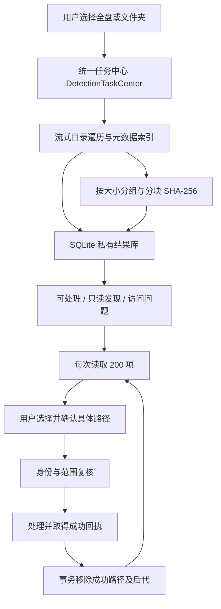

# 从磁盘到可审阅的处理



## 为什么不会靠截断结果节省内存

`MetadataTreeWalker` 使用目录流；超过同时打开目录流预算的部分写入磁盘队列。`ScanCandidateIndex`、`ScanSimilarityIndex`、`ScanResultStore` 等保存全量候选、摘要和结果。SQLite 页面缓存约 2 MiB、临时排序落盘、关闭 mmap；SHA-256 每次读 1 MiB。UI 只加载当前 200 项，JSON 导出逐项写入。

没有承诺常驻内存恒定或任何负载都低于某一数值。磁盘索引也需要可用空间；写入失败会报告不完整。

## 任务属于应用

`DetectionTaskCenter` 持有单任务票据，`FeatureStateRegistry` 保存控制器与最近报告引用。页面消失只改变呈现状态，后台继续。取消后等 worker 真正退出再释放票据；迟到回调不能释放新任务。轻量系统监控采样与文件检测分开。

该名额仅对同一应用实例有效，独立 CLI / 另一旧版本进程不共享。退出应用后不继续工作。

## 分批处理保留同一份报告

`TrashManager` / `TrashInspector` 返回真实成功路径。`ScanResultStore.removeProcessedPaths` 先验证整批输入，再在同一事务按路径字节边界删除索引行，重算统计。失败项、父目录和前缀相邻文件不随之移除。它只编辑结果索引，不执行源文件删除。

文件处理和结果索引同步是两个步骤。索引同步失败时保留报告并提示，避免把文件操作已成功误报为从未发生。正常模块可幂等补同步，其他模块按明确提示刷新或重新检查。

## 目录结构

```text
Sources/CleanRoomCore/    扫描、索引、范围保护、历史、外部引擎接口
Sources/CleanRoomMac/     SwiftUI 界面、控制器与任务中心
Sources/cleanroom/        只读 CLI
Sources/CSQLite/          系统 SQLite 模块桥接
Tests/                   生成夹具行为检查、原生控制器和布局回归
scripts/                 构建、打包、安装、隔离验证与截图复现
docs/                    使用边界、架构、验证范围和视觉素材
```

`CleanRoomCore` 等内部名称沿用早期工程标识；公开产品名为 AIYOUClean。
